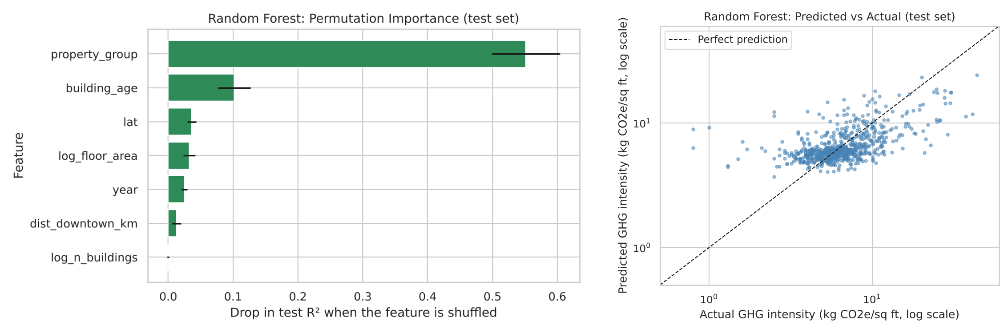
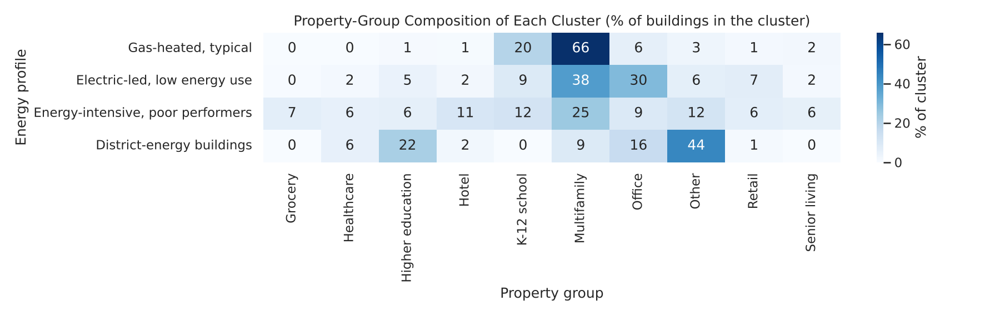

# Introduction

Buildings are one of the largest sources of greenhouse gas emissions in big US cities, and cutting them
through retrofits, electrification and better operation is a fast-growing part of the climate-tech
industry. Chicago's Energy Benchmarking Ordinance requires every building of 50,000 sq ft or more to
report its annual energy use, and the city publishes the results as the **Chicago Energy Benchmarking**
dataset (City of Chicago Data Portal). It contains 28,329 building-year reports from 3,852 buildings for
2014–2023. Each report gives the property type, floor area, year built, number of buildings, community
area and location; annual electricity, natural gas, district steam, district chilled water and other
fuel use; site energy use intensity (EUI, kBtu per sq ft); the ENERGY STAR score (1–100, relative to
similar buildings nationwide); and total emissions and **GHG intensity** (kg CO2e per sq ft per year).

Reports without energy data (mostly "Not Submitted" or "Exempt"), 74 implausible values and 16 records
without floor area, year built or location were removed, leaving **21,618 building-years**. More than 60
property types were grouped into 10 categories, and new features were built: building age, log floor
area, distance to downtown, and each building's energy mix (shares of electricity, gas and district
energy). The models use each building's latest report (**3,448 buildings**, 75% from 2023). Exploration
showed that GHG intensity is right-skewed (median 6.2 kg CO2e/sq ft), varies strongly by property type
(grocery 23.9, healthcare 16.4, multifamily 5.6) and is concentrated: 10% of buildings produce 51% of all
emissions. Among the 743 buildings that reported every year, median GHG intensity fell **19.5%** between
2018 and 2023, partly because the electricity grid became cleaner. Every analysis was done in both Python
and R with matching results.

# Question 1: Which building characteristics best predict GHG intensity?

## Introduction

Cities and retrofit companies would like to know which buildings are likely to be heavy emitters before
seeing their energy bills, for example to target outreach or estimate the market for upgrades. This
question asks how well the characteristics recorded for every building (property type, floor area, age,
number of buildings, location and data year) predict its GHG intensity, and which of them matter. Energy
use is deliberately left out, because emissions are calculated directly from it. I am interested in
this question because it tests whether building records alone can guide decarbonization efforts.

## Approach

Three regression models were compared with a reference model that uses property type only. **Linear
regression** is a transparent baseline whose coefficients give the direction and size of each effect. A
**regression tree** (depth 5, at least 30 buildings per leaf) gives readable rules. A **random forest**
(400 trees) can capture interactions, such as age mattering differently for schools and apartments. The
target is **log GHG intensity**, because the raw values are strongly right-skewed. Numeric features were
standardized (z-scores) and property type one-hot encoded. Each building appears once (its latest
report), so the same building cannot be in both the training and the test set. The data were split
80/20 (stratified by property type) with 5-fold cross-validation on the training set, and models were
judged by **R²**, RMSE and MAE. Importance was measured by **permutation** (the drop in test R² when a
feature is shuffled) and by the linear coefficients.

## Data analysis and results

| Model | CV R² | Test R² | Test RMSE (log) | Test MAE (kg CO2e/sq ft) | Test R² (R) |
|--------------------|--------------|--------|--------|--------|--------|
| Property type only | 0.245 ± 0.028 | 0.276 | 0.418 | 2.26 | 0.316 |
| Linear regression | 0.245 ± 0.034 | 0.287 | 0.415 | 2.25 | 0.317 |
| Regression tree | 0.200 ± 0.019 | 0.223 | 0.433 | 2.38 | 0.284 |
| Random forest | 0.258 ± 0.031 | **0.312** | **0.408** | 2.25 | 0.331 |

: Test-set performance (Python). The last column is the R replication, which uses its own random split.

Building characteristics predict GHG intensity only weakly. The best model, the random forest, explains
**31%** of the variance on the test set, and **property type alone explains 28%**, so age, size,
location and year add only 3–4 percentage points (Table 1). Shuffling property type lowers the forest's
R² by 0.55, five times more than the next feature, building age (0.10); floor area, latitude, year and
distance to downtown matter little (Figure 1). In the linear model, multifamily buildings emit 71% less
per sq ft than grocery stores, K-12 schools 68% less, offices 64% less and healthcare buildings only 16%
less. Predictions are off by 2.25 kg CO2e/sq ft on average, against a median building of 6.2, and they
are pulled toward each type's typical value. The R models give the same ranking (test R² 0.28–0.33).

## Discussion

A building's type tells us the range its emissions are likely to fall in, because uses such as grocery
refrigeration or hospital ventilation need far more energy per sq ft than apartments or offices. Where a
building falls within that range, however, depends on its heating system, insulation, controls and how
it is run, none of which the city's records describe; even the random forest leaves about 70% of the
variation unexplained. Age has a small, non-linear effect: multifamily buildings aged 25–74 emit slightly
more than newer and very old ones, perhaps reflecting mid-century construction or past renovations of the
oldest stock. This is a useful negative result for the industry: screening buildings by their
characteristics cannot replace measured energy data, which is exactly what benchmarking provides.
Limitations: self-reported data, one report per building (mostly 2023), and broad property groups.

# Question 2: What distinct energy-use profiles exist among Chicago's large buildings?

## Introduction

Question 1 showed that characteristics alone say little about emissions. This question uses the energy
data directly to ask how buildings *use* energy, without predefined labels. Grouping buildings into
energy-use profiles matters because each profile needs a different decarbonization strategy: efficiency
retrofits, switching from gas to electric heating, or cleaner district or grid energy. The analysis uses
each building's energy use intensity, GHG intensity and energy mix, and describes the resulting groups by
property type, age, size and ENERGY STAR score.

## Approach

**k-means clustering** was applied to five standardized features for the 3,448 buildings: log site EUI,
log GHG intensity, and the shares of site energy from electricity, natural gas and district
steam/chilled water. Logs reduce skew and standardization lets each feature count equally in the
distance calculation. The ENERGY STAR score was not used to form clusters, because it is missing for 14%
of buildings, but it was used to describe them. k-means was run with 25 random starts for *k* = 2 to 8,
and *k* was chosen by combining the **elbow method** (within-cluster sum of squares) with the **average
silhouette width**. Clusters were named from their average profiles (a principal-component view is in
the notebooks).

## Data analysis and results

The silhouette was highest for *k* = 2 and 3 (0.418 and 0.417) and 0.378 for *k* = 4, where the elbow
bends. **k = 4** was chosen because it is the elbow and, unlike two or three clusters, separates the
district-energy buildings, which need a different strategy.

| Profile | Buildings | Median EUI (kBtu/sq ft) | Median GHG (kg/sq ft) | Electricity / gas / district share | Median ENERGY STAR | Share of total GHG |
|----------------------|------|------|------|------------------|------|------|
| Gas-heated, typical | 1,946 | 68.7 | 5.4 | 28% / 71% / 0% | 70 | 32% |
| Electric-led, low energy use | 733 | 55.3 | 6.5 | 79% / 21% / 1% | 67 | 27% |
| Energy-intensive, poor performers | 680 | 120.8 | 10.4 | 42% / 58% / 0% | 26 | **33%** |
| District-energy buildings | 89 | 140.9 | 12.0 | 30% / 2% / 68% | 54.5 | 7% |

: The four energy-use profiles (Python; R finds the same profiles, with sizes within 2 buildings).

The **gas-heated, typical** cluster (56% of buildings) is mostly multifamily housing (66%) and schools
(20%): it gets 71% of its energy from gas and has the lowest GHG intensity. The **electric-led** cluster,
where most offices sit, uses the least energy yet has a *higher* GHG intensity (6.5) than the gas-heated
group, because grid electricity carries more CO2 per unit than gas burned on site. The
**energy-intensive** cluster uses nearly twice the energy of a typical building and has a median ENERGY
STAR score of just **26**; hotels, groceries and healthcare are over-represented, but a quarter of it is
multifamily housing and 12% schools. With only 20% of the buildings it produces **33% of all
emissions**. The small **district-energy** cluster (universities and other campuses) has the highest
energy and GHG intensity (Table 2, Figure 2).

## Discussion

The four profiles point to four strategies. The **energy-intensive** buildings are the priority for audits
and retrofits: they emit a third of the total, and an ENERGY STAR score of 26 means they use more energy
than three-quarters of similar buildings nationwide, often for fixable reasons such as old boilers or
poor controls. The **gas-heated** buildings are already fairly efficient, but their emissions will not
fall with a cleaner grid, so they are the main market for **electrification** with heat pumps. The
**electric-led** buildings will get cleaner as the grid does, helped by clean-power purchasing or solar,
and the **district-energy** buildings depend on how the central plants are fuelled. Together with
Question 1, this shows that every building type contains poor performers that only energy data can
reveal. The clusters overlap at their edges (silhouette 0.38), the results depend on the chosen features,
and the GHG figures depend on the emission factors used for electricity and steam.

# References

City of Chicago (2025). *Chicago Energy Benchmarking* [dataset]. City of Chicago Data Portal.
https://data.cityofchicago.org/Environment-Sustainable-Development/Chicago-Energy-Benchmarking/xq83-jr8c

Han, J., Pei, J., & Tong, H. (2023). *Data Mining: Concepts and Techniques* (4th ed.). Morgan Kaufmann.

**Code:** `python/01–03_*.ipynb` and `r/01–03_*.Rmd` in the project folder reproduce every result.
